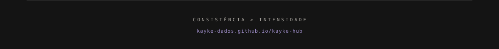

 intensidade"
/>

<a href="#sobre-mim">sobre mim</a> · <a href="#destaque">destaque</a> · <a href="#cartão-digital">cartão digital</a> · <a href="#diário">diário</a> · <a href="#tecnologias">tecnologias</a> · <a href="#projetos">projetos</a> · <a href="#github-stats">stats</a> · <a href="#snake-contribution">snake</a> · <a href="#vamos-conversar">conversar</a>

---

## sobre mim

Estudando para me tornar **Analista de Dados** — **Python** na mão, base de TI e o pacote Office na bagagem, um dia por vez. Este perfil é um diário de bordo, não uma vitrine.

A base que já carrego: **noções básicas de TI** e o **pacote Office** em nível iniciante — planilhas, documentos e apresentações fazem parte do meu dia a dia. O aprendizado do momento é **Python**, do zero, sem atalhos; a trilha completa está no [python-journey](https://github.com/kayke-dados/Python-Journey).

> Consistência > intensidade.

---

## destaque

**[python-journey](https://github.com/kayke-dados/Python-Journey)**

*do primeiro `print()` às funções próprias — cada pasta é uma etapa, cada arquivo um conceito explicado*

&nbsp;

| capítulo | estudos | estado |
|:---|:---:|:---|
| 01 — fundamentos | 12 | concluído |
| 02 — condições | 16 | concluído |
| 03 — laços e lógica | 25 | concluído |
| 04 — listas e tuplas | 18 | concluído |
| 05 — dicionários | 5 | concluído |
| 06 — funções | 9/10 | `ex105` pendente |
| 07 — próximos | — | espaço reservado |

**85 de 86 exercícios**: 5 capítulos concluídos, o 06 em 9/10 e o 07 reservado. Base: [Curso em Vídeo](https://www.youtube.com/@CursoemVideo).

↳ <a href="https://github.com/kayke-dados/Python-Journey/tree/main/01-fundamentos">abrir o capítulo 01 — fundamentos</a>

---

## cartão digital

<a href="https://kayke-dados.github.io/kayke-hub/"><strong>kayke-hub</strong></a> — cartão digital bilíngue, com QR Code, projetos e a jornada de estudos. Estático, acessível e no ar.

---

## diário

- `2026-10-30` — **kayke-hub** reformulado (v4, editorial ametista) e no ar.
- `2026-10-30` — perfil no ar; foco: python, do zero.
- `2026-10-30` — primeiro resultado real: **python-journey** no ar, 85 de 86 exercícios.

---

## tecnologias

&nbsp;

*Python é o foco; Windows e Office sustentam o caminho, no ritmo de iniciante.*

---

## projetos

| projeto | foco | status |
|:---|:---|:---:|
| [python-journey](https://github.com/kayke-dados/Python-Journey) | aprendizado completo de Python — 85 de 86 exercícios |  |
| [kayke-hub](https://kayke-dados.github.io/kayke-hub/) | cartão digital e portfólio — bilíngue, QR, estático |  |
| portfólio de dados | a definir |  |
| painel de indicadores | planilha |  |

*O que ainda não existe aparece como planejamento — sem projeto inventado para preencher vitrine.*

---

## github stats

<!-- depois do primeiro star/issue/PR, remova o parâmetro hide= da linha acima -->

---

## snake contribution

<picture>
  <source media="(prefers-color-scheme: dark)" srcset="https://raw.githubusercontent.com/kayke-dados/kayke-dados/output/github-snake-dark.svg" />
  <source media="(prefers-color-scheme: light)" srcset="https://raw.githubusercontent.com/kayke-dados/kayke-dados/output/github-snake.svg" />
  
</picture>

*a cobra come as contribuições reais e cresce com os commits — workflow próprio, atualizado semanalmente.*

---

## vamos conversar

&nbsp;

&nbsp;

 intensidade — kayke-dados.github.io/kayke-hub"
/>

<!-- ============================================================
     SNAKE: como ativar
     ------------------------------------------------------------
     O workflow já entra pronto no repo (.github/workflows/snake.yml).
     1) Publicado o repo, vá em Actions e rode "snake" uma vez
        (Run workflow), sem esperar o cron semanal.
     2) A branch "output" nasce com os dois SVGs,
        que o <picture> acima passa a carregar sozinho.
     ============================================================ -->
