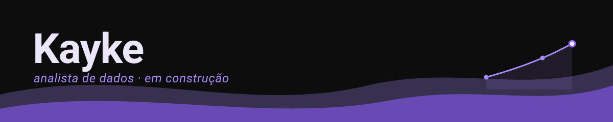

<!-- Snake: ative o "snake game" seguindo o comentário no final deste arquivo -->

## sobre mim

Sou **Kayke**, estudando para me tornar **Analista de Dados**.

A base que já carrego: **noções básicas de T.I.** e o **pacote Office** completo em nível iniciante — planilhas, documentos e apresentações fazem parte do meu dia a dia.

O aprendizado do momento: **Python**, do zero — sem atalhos, um passo de cada vez. Este perfil é o meu diário de bordo, não uma vitrine.

O que você encontra por aqui hoje:

- Estudos registrados, repositórios de prática e testes que não dão certo (e os que dão)
- Projetos **a caminho** — fechados com calma antes de publicados
- Evolução lenta, mas constante

> Consistência > intensidade.

## tecnologias

&nbsp;

&nbsp;

*Python é o foco atual — Office e T.I. são a base de partida, não o destino.*

## projetos

| projeto | foco | status |
|:---|:---|:---:|
| portfólio de dados | a definir |  |
| projeto em Python | análise de dados |  |
| painel de indicadores | planilha |  |

*O primeiro resultado real entra aqui, com link — sem card de vitrine.*

## github stats

<!-- depois do primeiro star/issue/PR, remova o parâmetro hide= da linha acima -->

## snake contribution

<picture>
  <source media="(prefers-color-scheme: dark)" srcset="https://raw.githubusercontent.com/kayke-dados/kayke-dados/output/github-snake-dark.svg" />
  <source media="(prefers-color-scheme: light)" srcset="https://raw.githubusercontent.com/kayke-dados/kayke-dados/output/github-snake.svg" />
  
</picture>

## vamos conversar

&nbsp;

<!-- ============================================================
     SNAKE: como ativar
     ------------------------------------------------------------
     O workflow já entra pronto no repo (.github/workflows/snake.yml).
     1) Publicado o repo, vá em Actions e rode "snake" uma vez
        (Run workflow), sem esperar o cron semanal.
     2) A branch "output" nasce com os dois SVGs,
        que o <picture> acima passa a carregar sozinho.
     ============================================================ -->
